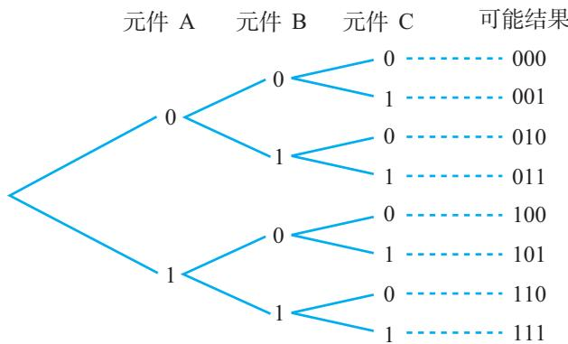

解：（1）分别用 $x_{1}$ ， $x_{2}$ 和 $x_{3}$ 表示元件 A，B 和 C 的可能状态，则这个电路的工作状态可用 $(x_{1}, x_{2}, x_{3})$ 表示。进一步地，用 1 表示元件的“正常”状态，用 0 表示“失效”状态，则样本空间

$$
\begin{array}{c} \Omega = \{(0, 0, 0), (1, 0, 0), (0, 1, 0), (0, 0, 1), \\ (1, 1, 0), (1, 0, 1), (0, 1, 1), (1, 1, 1) \}. \end{array}
$$

如图 10.1-3，还可以借助树状图帮助我们列出试验的所有可能结果.

  
图10.1-3

（2）“恰好两个元件正常”等价于 $(x_{1}, x_{2}, x_{3}) \in \Omega$ ，且 $x_{1}, x_{2}, x_{3}$ 中恰有两个为 1，所以

$$
M = \{(1, 1, 0), (1, 0, 1), (0, 1, 1) \}.
$$

“电路是通路”等价于 $(x_{1}, x_{2}, x_{3}) \in \Omega, x_{1} = 1$ ，且 $x_{2}, x_{3}$ 中至少有一个是1，所以 $N = \{(1, 1, 0), (1, 0, 1), (1, 1, 1)\}$ .

同理，“电路是断路”等价于 $(x_{1}, x_{2}, x_{3})\in\Omega$ ， $x_{1}=0$ ，或 $x_{1}=1$ ， $x_{2}=x_{3}=0$ 。所以 $T=\{(0,0,0),(0,1,0),(0,0,1),(0,1,1),(1,0,0)\}$ .

第十章 概率

对应题目：[Q070000000896](../Q070000000896.md)

> 来源：高中必修 第二册·人教A版数学
