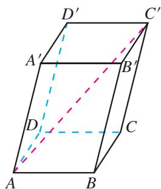

> [!faq]- 高中选择性必修 第一册·人教A版数学
> 解：（1） $\overrightarrow{AB}\cdot\overrightarrow{AD}=|\overrightarrow{AB}||\overrightarrow{AD}|\cos\langle\overrightarrow{AB},\overrightarrow{AD}\rangle$ $=5\times3\times\cos60^{\circ}=7.5;$
>
> 
> 图1.1-12
>
> 
>
> $$
> \begin{array}{r l} | \overrightarrow {A C ^ {\prime}} | ^ {2} & = (\overrightarrow {A B} + \overrightarrow {A D} + \overrightarrow {A A ^ {\prime}}) ^ {2} \\ & = | \overrightarrow {A B} | ^ {2} + | \overrightarrow {A D} | ^ {2} + | \overrightarrow {A A ^ {\prime}} | ^ {2} + 2 (\overrightarrow {A B} \cdot \overrightarrow {A D} + \overrightarrow {A B} \cdot \overrightarrow {A A ^ {\prime}} + \overrightarrow {A D} \cdot \overrightarrow {A A ^ {\prime}}) \\ & = 5 ^ {2} + 3 ^ {2} + 7 ^ {2} + 2 (5 \times 3 \times \cos 6 0 ^ {\circ} + 5 \times 7 \times \cos 4 5 ^ {\circ} + 3 \times 7 \times \cos 4 5 ^ {\circ}) \\ & = 9 8 + 5 6 \sqrt {2}, \end{array}
> $$
>
> 所以 $AC' \approx 13.3.$
>
> 由于空间向量的线性运算和数量积运算具有鲜明的几何背景，空间图形的许多性质可以由向量的线性运算及数量积运算表示出来，因此，立体几何中的许多问题可以用向量运算的方法加以解决.
