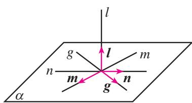

> [!faq]- 高中选择性必修 第一册·人教A版数学
> 分析：要证明 $l \perp \alpha$ ，就是要证明 $l$ 垂直于 $\alpha$ 内的任意一条直线 $g$ （直线与平面垂直的定义）。如果我们能在 $g$ 和 $m, n$ 之间建立某种联系，并由 $l \perp m, l \perp n$ ，得到 $l \perp g$ ，那么就能解决此问题。
>
> 
> 图1.1-13
>
> 证明：在平面 $\alpha$ 内作任意一条直线 $g$ ，分别在直线 $l$ ， $m$ ， $n$ ， $g$ 上取非零向量 $l$ ， $m$ ， $n$ ， $g$ 。
>
> 因为直线 $m$ 与 $n$ 相交，所以向量 $\pmb{m}$ ， $\pmb{n}$ 不平行。由向量共面的充要条件可知，存在唯一的有序实数对 $(x, y)$ ，使
>
> $$
> \mathbf {g} = x \mathbf {m} + y \mathbf {n}.
> $$
>
> 将上式两边分别与向量 $l$ 作数量积运算，得
>
> $$
> \boldsymbol {l} \cdot \boldsymbol {g} = x \boldsymbol {l} \cdot \boldsymbol {m} + y \boldsymbol {l} \cdot \boldsymbol {n}.
> $$
>
> 因为 $l \cdot m = 0$ , $l \cdot n = 0$ （为什么？），所以 $l \cdot g = 0$ .
> 所以 $l \perp g$ .
>
> 例3即为直线与平面垂直的判定定理的证明过程．尝试用综合几何方法证明这个定理，并比较两种方法，你能从中体会到向量方法的优越性吗？
>
> 这就证明了直线 $l$ 垂直于平面 $\alpha$ 内的任意一条直线，所以 $l \perp \alpha$ .
