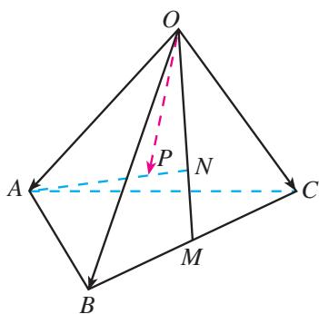

> [!faq]- 高中选择性必修 第一册·人教A版数学
> 分析： $\overrightarrow{OA}$ ， $\overrightarrow{OB}$ ， $\overrightarrow{OC}$ 是三个不共面的向量，它们构成空间的一个基底 $\{\overrightarrow{OA}, \overrightarrow{OB}, \overrightarrow{OC}\}$ ， $\overrightarrow{OP}$ 可以用基底 $\{\overrightarrow{OA}, \overrightarrow{OB}, \overrightarrow{OC}\}$ 表示出来.
>
> $$
> \begin{array}{r l} \text {解:} & \overrightarrow {O P} = \overrightarrow {O A} + \overrightarrow {A P} = \overrightarrow {O A} + \frac {3}{4} \overrightarrow {A N} \\ & = \overrightarrow {O A} + \frac {3}{4} (\overrightarrow {O N} - \overrightarrow {O A}) \\ & = \overrightarrow {O A} + \frac {3}{4} \overrightarrow {O N} - \frac {3}{4} \overrightarrow {O A} \\ & = \frac {1}{4} \overrightarrow {O A} + \frac {3}{4} \left(\frac {1}{3} \overrightarrow {O B} + \frac {1}{3} \overrightarrow {O C}\right) \\ & = \frac {1}{4} \overrightarrow {O A} + \frac {1}{4} \overrightarrow {O B} + \frac {1}{4} \overrightarrow {O C}. \end{array}
> $$
>
> 
> 图1.2-2
