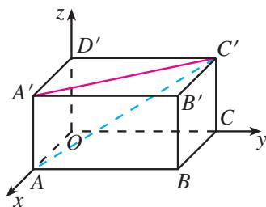

解：（1）点 $D'$ 在 z 轴上，且 $OD' = 2$ ，所以 $\overrightarrow{OD'} = 0i + 0j + 2k$ 。所以点 $D'$ 的坐标是 $(0, 0, 2)$ 。

同理，点 C 的坐标是 $(0, 4, 0)$ .

点 $A'$ 在 x 轴、y 轴、z 轴上的射影分别为 A, O, $D'$ ，它们在坐标轴上的坐标分别为 3, 0, 2，所以点 $A'$ 的坐标是 $(3, 0, 2)$ .

图1.3-6

点 $B'$ 在 x 轴、y 轴、z 轴上的射影分别为 A, C, $D'$ ，它们在坐标轴上的坐标分别为 3, 4, 2，所以点 $B'$ 的坐标是（3, 4, 2）.

(2) $\overrightarrow{A'B'} = \overrightarrow{OC} = 0\mathbf{i} + 4\mathbf{j} + 0\mathbf{k} = (0, 4, 0)$ ;

$$
\overrightarrow {B ^ {\prime} B} = - \overrightarrow {O D ^ {\prime}} = 0 \boldsymbol {i} + 0 \boldsymbol {j} - 2 \boldsymbol {k} = (0, 0, - 2);
$$

$$
\overrightarrow {A ^ {\prime} C ^ {\prime}} = \overrightarrow {A ^ {\prime} D ^ {\prime}} + \overrightarrow {D ^ {\prime} C ^ {\prime}} = - 3 \boldsymbol {i} + 4 \boldsymbol {j} + 0 \boldsymbol {k} = (- 3, 4, 0);
$$

$$
\overrightarrow {A C ^ {\prime}} = \overrightarrow {A O} + \overrightarrow {O C} + \overrightarrow {C C ^ {\prime}} = - 3 i + 4 j + 2 k = (- 3, 4, 2).
$$

对应题目：[Q070000001015](../Q070000001015.md)

> 来源：高中选择性必修 第一册·人教A版数学
