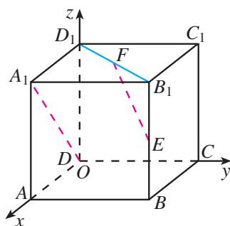

> [!faq]- 高中选择性必修 第一册·人教A版数学
> 分析：要证明 $EF \perp DA_{1}$ ，只要证明 $\overrightarrow{EF} \perp \overrightarrow{DA_{1}}$ ，即证 $\overrightarrow{EF} \cdot \overrightarrow{DA_{1}} = 0$ 。我们只要用坐标表示 $\overrightarrow{EF}, \overrightarrow{DA_{1}}$ ，并进行数量积运算即可。
>
> 
>
> 证明：不妨设正方体的棱长为1，建立如图1.3-8所示的空间直角坐标系 $Oxyz$ ，则
>
> 图1.3-8
>
> $$
> E \left(1, 1, \frac {1}{2}\right), F \left(\frac {1}{2}, \frac {1}{2}, 1\right),
> $$
>
> 所以 $\overrightarrow{EF} = \left(-\frac{1}{2}, -\frac{1}{2}, \frac{1}{2}\right)$ .
>
> 又 $A_{1}(1,0,1),D(0,0,0)$ 所以 $\overrightarrow{DA_1} = (1,0,1).$
>
> 所以 $\overrightarrow{EF} \cdot \overrightarrow{DA_1} = \left(-\frac{1}{2}, -\frac{1}{2}, \frac{1}{2}\right) \cdot (1, 0, 1) = 0.$
>
> 所以 $\overrightarrow{EF} \perp \overrightarrow{DA_{1}}$ ，即 $EF \perp DA_{1}$ .
>
> 你能从本题的解答中体会到根据问题的特点，建立适当的空间直角坐标系，用向量表示相关元素，并通过向量及其坐标的运算求解问题的基本思路吗？
