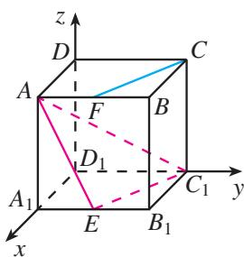

分析：根据条件建立空间直角坐标系，用坐标表示相关的点、直线的方向向量和平面的法向量，再利用有关公式，通过坐标运算得出相应的距离.

解：以 $D_{1}$ 为原点， $D_{1}A_{1}, D_{1}C_{1}, D_{1}D$ 所在直线分别为 $x$ 轴、 $y$ 轴、 $z$ 轴，建立如图1.4-18所示的空间直角坐标系，则 $A(1,0,1), B(1,1,1), C(0,1,1), C_{1}(0,1,0), E(1,\frac{1}{2},0), F(1,\frac{1}{2},1)$ ，所以

  
图1.4-18

$$
\overrightarrow {A B} = (0, 1, 0), \overrightarrow {A C _ {1}} = (- 1, 1, - 1), \overrightarrow {A E} = (0, \frac {1}{2}, - 1),
$$

$$
\overrightarrow {E C _ {1}} = (- 1, \frac {1}{2}, 0), \overrightarrow {F C} = (- 1, \frac {1}{2}, 0), \overrightarrow {A F} = (0, \frac {1}{2}, 0).
$$

(1) 取 $\boldsymbol{a}=\overrightarrow{AB}=(0,1,0)$ ， $\boldsymbol{u}=\frac{\overrightarrow{AC_{1}}}{|\overrightarrow{AC_{1}}|}=\frac{\sqrt{3}}{3}(-1,1,-1)$ ，则 $a^{2}=1,\quad a\cdot u=\frac{\sqrt{3}}{3}$ .
所以，点 B 到直线 $AC_{1}$ 的距离为

$$
\sqrt {\boldsymbol {a} ^ {2} - (\boldsymbol {a} \cdot \boldsymbol {u}) ^ {2}} = \sqrt {1 - \frac {1}{3}} = \frac {\sqrt {6}}{3}.
$$

（2）因为 $\overrightarrow{FC} = \overrightarrow{EC_1} = (-1, \frac{1}{2}, 0)$ ，所以 $FC // EC_1$ ，所以 $FC // \text{平面 } AEC_1$ 。所以点 $F$ 到平面 $AEC_1$ 的距离即为直线 $FC$ 到平面 $AEC_1$ 的距离。

设平面 $AEC_{1}$ 的法向量为 $\boldsymbol{n}=(x,y,z)$ ，则

$$
\left\{ \begin{array}{l} \boldsymbol {n} \cdot \overrightarrow {A E} = 0, \\ \boldsymbol {n} \cdot \overrightarrow {E C _ {1}} = 0. \end{array} \right.
$$

所以

$$
\left\{ \begin{array}{l} \frac {1}{2} y - z = 0, \\ - x + \frac {1}{2} y = 0. \end{array} \right.
$$

所以

$$
\left\{ \begin{array}{l} x = z, \\ y = 2 z. \end{array} \right.
$$

取 z=1，则 x=1，y=2。所以， $n=(1,2,1)$ 是平面 $AEC_{1}$ 的一个法向量。

又因为 $\overrightarrow{AF} = (0, \frac{1}{2}, 0)$ ，所以点 $F$ 到平面 $AEC_{1}$ 的距离为

$$
\frac {| \overrightarrow {A F} \cdot \boldsymbol {n} |}{| \boldsymbol {n} |} = \frac {\left| (0 , \frac {1}{2} , 0) \cdot (1 , 2 , 1) \right|}{\sqrt {6}} = \frac {\sqrt {6}}{6}.
$$

即直线 $FC$ 到平面 $AEC_{1}$ 的距离为 $\frac{\sqrt{6}}{6}$ .

与用平面向量解决平面几何问题的“三步曲”类似，我们可以得出用空间向量解决立体几何问题的“三步曲”：

（1）建立立体图形与空间向量的联系，用空间向量表示问题中涉及的点、直线、平面，把立体几何问题转化为向量问题；

（2）通过向量运算，研究点、直线、平面之间的位置关系以及它们之间的距离和夹角等问题；

（3）把向量运算的结果“翻译”成相应的几何结论.

对应题目：[Q070000001046](../Q070000001046.md)

> 来源：高中选择性必修 第一册·人教A版数学
