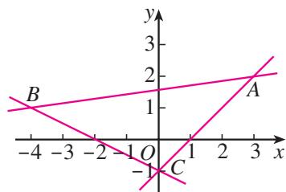

解：直线 $AB$ 的斜率 $k_{AB} = \frac{1 - 2}{-4 - 3} = \frac{1}{7}$

直线 $BC$ 的斜率 $k_{BC} = \frac{-1 - 1}{0 - (-4)} = \frac{-2}{4} = -\frac{1}{2}$

直线 $CA$ 的斜率 $k_{CA} = \frac{2 - (-1)}{3 - 0} = \frac{3}{3} = 1.$

由 $k_{AB}>0$ 及 $k_{CA}>0$ 可知，直线 AB 与 CA 的倾斜角均为锐角；由 $k_{BC}<0$ 可知，直线 BC 的倾斜角为钝角.

图2.1-6

对应题目：[Q070000001098](../Q070000001098.md)

> 来源：高中选择性必修 第一册·人教A版数学
