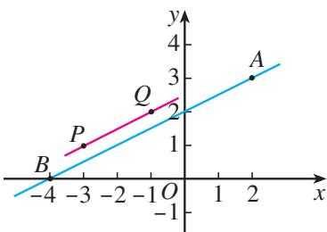

> [!faq]- 高中选择性必修 第一册·人教A版数学
> 解：如图2.1-8，由已知可得
>
> 直线 BA 的斜率 $k_{BA}=\frac{3-0}{2-(-4)}=\frac{1}{2}$ ,
>
> 直线 $PQ$ 的斜率 $k_{PQ} = \frac{2 - 1}{-1 - (-3)} = \frac{1}{2}$ .
>
> 因为 $k_{BA}=k_{PQ}$ ，所以直线 $AB\parallel PQ$ .
>
> 
> 图2.1-8
