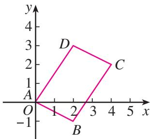

> [!faq]- 高中选择性必修 第一册·人教A版数学
> 解：如图2.1-9，由已知可得
>
> AB 边所在直线的斜率 $k_{AB} = -\frac{1}{2}$ ,
>
> CD 边所在直线的斜率 $k_{CD} = -\frac{1}{2}$ ,
>
> BC 边所在直线的斜率 $k_{BC}=\frac{3}{2}$ ,
>
> 
> 图2.1-9
>
> DA 边所在直线的斜率 $k_{DA}=\frac{3}{2}$ .
>
> 因为 $k_{AB}=k_{CD}$ ， $k_{BC}=k_{DA}$ ，所以 $AB\parallel CD$ ， $BC\parallel DA$ 。
>
> 因此四边形 ABCD 是平行四边形.
>
> 显然，当两条直线相交时，它们的斜率不相等；反之，当两条直线的斜率不相等时，它们相交．在相交的位置关系中，垂直是最特殊的情形．当直线 $l_{1}$ ， $l_{2}$ 垂直时，它们的斜率除了不相等外，是否还有特殊的数量关系？
>
> 设两条直线 $l_{1}$ ， $l_{2}$ 的斜率分别为 $k_{1}$ ， $k_{2}$ ，则直线 $l_{1}$ ， $l_{2}$ 的方向向量分别是 $\pmb {a} = (1,$ $k_{1})$ ， $\pmb {b} = (1,k_2)$ ，于是
>
> $$
> l _ {1} \perp l _ {2} \Leftrightarrow \boldsymbol {a} \perp \boldsymbol {b} \Leftrightarrow \boldsymbol {a} \cdot \boldsymbol {b} = 0 \Leftrightarrow 1 \times 1 + k _ {1} k _ {2} = 0, \text {即} k _ {1} k _ {2} = - 1.
> $$
>
> 也就是说， $l_{1} \perp l_{2} \Leftrightarrow k_{1} k_{2} = -1.$
>
> 当直线 $l_{1}$ 或 $l_{2}$ 的倾斜角为 $90^{\circ}$ 时，若 $l_{1} \perp l_{2}$ ，则另一条直线的倾斜角为 $0^{\circ}$ ；反之亦然.
>
> 由上我们得到，如果两条直线都有斜率，且它们互相垂直，那么它们的斜率之积等于
>
> -1；反之，如果两条直线的斜率之积等于-1，那么它们互相垂直．即
>
> $$
> l _ {1} \perp l _ {2} \Longleftrightarrow k _ {1} k _ {2} = - 1.
> $$
