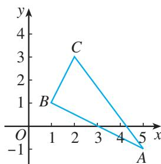

> [!faq]- 高中选择性必修 第一册·人教A版数学
> 分析：如图2.1-10，猜想 $AB \perp BC$ ， $\triangle ABC$ 是直角三角形.
>
> 解：边 $AB$ 所在直线的斜率 $k_{AB} = -\frac{1}{2}$ ，边 $BC$ 所在直线的斜率 $k_{BC} = 2$ .
>
> 由 $k_{AB}k_{BC}=-1$ ，得 $AB\perp BC$ ，即 $\angle ABC=90^{\circ}$ .
>
> 所以 $\triangle ABC$ 是直角三角形.
>
> 
> 图2.1-10
