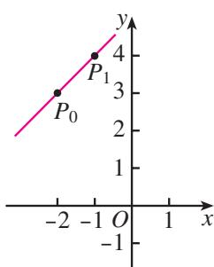

解：直线 l 经过点 $P_{0}(-2,3)$ ，斜率 $k=\tan45^{\circ}=1$ ，代入点斜式方程得

$$
y - 3 = x + 2.
$$

画图时，只需再找出直线 l 上的另一点 $P_{1}(x_{1}, y_{1})$ ，例如，取 $x_{1} = -1$ ，则 $y_{1} = 4$ ，得点 $P_{1}$ 的坐标为 $(-1, 4)$ ，过 $P_{0}, P_{1}$ 两点的直线即为所求，如图 2.2-4 所示.

图2.2-4

下面我们看点斜式的一种特殊情形：如果斜率为 $k$ 的直线 $l$ 过点 $P_{0}(0, b)$ ，这时 $P_{0}$ 是直线 $l$ 与 $y$ 轴的交点，代入直线的点斜式方程，得

$$
y - b = k (x - 0),
$$

即

$$
\boxed {y = k x + b.}
$$

我们把直线 l 与 y 轴的交点 $(0, b)$ 的纵坐标 b 叫做直线 l 在 y 轴上的截距（intercept）。这样，方程 $y = kx + b$ 由直线的斜率 k 与它在 y 轴上的截距 b 确定，我们把方程 $y = kx + b$ 叫做直线的斜截式方程，简称斜截式（slope intercept form）。其中，k 和 b 均有明显的几何意义：k 是直线的斜率，b 是直线在 y 轴上的截距。

截距是距离吗？

对应题目：[Q070000001120](../Q070000001120.md)

> 来源：高中选择性必修 第一册·人教A版数学
