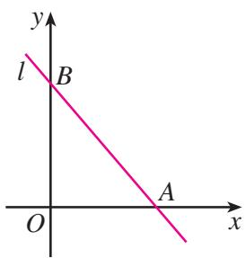

> [!faq]- 高中选择性必修 第一册·人教A版数学
> 解：将两点 $A(a,0),B(0,b)$ 的坐标代入两点式，得
>
> $$
> \frac {y - 0}{b - 0} = \frac {x - a}{0 - a},
> $$
>
> 
>
> 即
>
> $$
> \boxed { \begin{array}{c} \frac {x}{a} + \frac {y}{b} = 1. \end{array} }
> $$
>
> 图2.2-5
>
> 我们把直线 l 与 x 轴的交点 $(a, 0)$ 的横坐标 a 叫做直线 l 在 x 轴上的截距，此时直线 l 在 y 轴上的截距是 b．方程 $\frac{x}{a} + \frac{y}{b} = 1$ 由直线 l 在两条坐标轴上的截距 a 与 b 确定，我们把方程 $\frac{x}{a} + \frac{y}{b} = 1$ 叫做直线的截距式方程，简称截距式（intercept form）.
