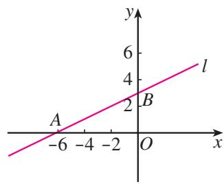

分析：求直线 $l$ 在 $x$ 轴上的截距，即求直线 $l$ 与 $x$ 轴交点的横坐标，只要在直线 $l$ 的方程中令 $y = 0$ 即可得 $x$ 的值.

解：把直线 $l$ 的一般式方程化为斜截式

$$
y = \frac {1}{2} x + 3.
$$

因此，直线 l 的斜率 $k=\frac{1}{2}$ ，它在 y 轴上的截距是 3.

在直线 $l$ 的方程 $x - 2y + 6 = 0$ 中，令 $y = 0$ ，得

  
图2.2-7

$$
x = - 6,
$$

即直线 l 在 x 轴上的截距是 -6.

由上面可得直线 $l$ 与 $x$ 轴、 $y$ 轴的交点分别为

$$
A (- 6, 0), B (0, 3),
$$

过 A, B 两点作直线，就得直线 l (图 2.2-7).

在直角坐标系中画直线时，通常找出直线与两条坐标轴的交点，然后连接这两个点.

结合例 6，我们可以从几何角度看一个二元一次方程，即一个二元一次方程表示一条直线.

在代数中，我们研究了二元一次方程的解。因为二元一次方程的每一组解都可以看成平面直角坐标系中一个点的坐标，所以这个方程的全体解组成的集合，就是坐标满足二元一次方程的全体点的集合，这些点的集合组成一条直线。

平面直角坐标系是把二元一次方程和直线联系起来的桥梁，这是笛卡儿的伟大贡献。在平面直角坐标系中，任意一个二元一次方程是直角坐标平面上一条确定的直线；反之，直角坐标平面上的任意一条直线可以用一个确定的二元一次方程表示。

对应题目：[Q070000001132](../Q070000001132.md)

> 来源：高中选择性必修 第一册·人教A版数学
