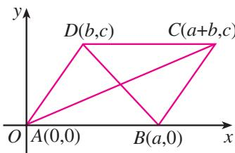

> [!faq]- 高中选择性必修 第一册·人教A版数学
> 分析：首先要建立适当的平面直角坐标系，用坐标表示有关的量，然后进行代数运算，最后把代数运算的结果“翻译”成几何关系.
>
> 
> 图2.3-4
>
> 证明：如图2.3-4，四边形ABCD是平行四边形．以顶点 $A$ 为原点，边 $AB$ 所在直线为 $x$ 轴，建立如图所示的平面直角坐标系.
>
> ?
>
> 在□ABCD中，点A的坐标是 $(0,0)$ ，设点B的坐标为 $(a,0)$ ，点D的坐标为 $(b,c)$ ，由平行四边形的性质，得点C的坐标为 $(a+b,c)$ .
>
> 如何由平行四边形的性质，得到点 C 的坐标为 $(a+b, c)$ ?
>
> 由两点间的距离公式，得
>
> $$
> \left| A C \right| ^ {2} = (a + b) ^ {2} + c ^ {2}, \quad \left| B D \right| ^ {2} = (b - a) ^ {2} + c ^ {2}, \quad \left| A B \right| ^ {2} = a ^ {2}, \quad \left| A D \right| ^ {2} = b ^ {2} + c ^ {2}.
> $$
>
> 所以
>
> $$
> \left| A C \right| ^ {2} + \left| B D \right| ^ {2} = 2 \left(a ^ {2} + b ^ {2} + c ^ {2}\right),
> $$
>
> 所以
>
> $$
> \vert A B \vert^ {2} + \vert A D \vert^ {2} = a ^ {2} + b ^ {2} + c ^ {2}.
> $$
>
> $$
> \left| A C \right| ^ {2} + \left| B D \right| ^ {2} = 2 \left(\left| A B \right| ^ {2} + \left| A D \right| ^ {2}\right),
> $$
>
> 即平行四边形两条对角线的平方和等于两条邻边的平方和的两倍.
