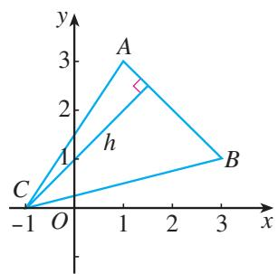

> [!faq]- 高中选择性必修 第一册·人教A版数学
> 分析：由三角形面积公式可知，只要利用距离公式求出边 $AB$ 的长和边 $AB$ 上的高即可.
>
> 解：如图2.3-7，设边 $AB$ 上的高为 $h$ ，则
>
> $$
> S _ {\triangle A B C} = \frac {1}{2} | A B | h.
> $$
>
> 
> 图2.3-7
>
> $$
> \vert A B \vert = \sqrt {(3 - 1) ^ {2} + (1 - 3) ^ {2}} = 2 \sqrt {2}.
> $$
>
> 边 $AB$ 上的高 $h$ 就是点 $C$ 到直线 $AB$ 的距离.
>
> 边 $AB$ 所在直线 $l$ 的方程为
>
> $$
> \frac {y - 3}{1 - 3} = \frac {x - 1}{3 - 1},
> $$
>
> 即 $x + y - 4 = 0$
>
> 点 $C(-1,0)$ 到直线 $l: x + y - 4 = 0$ 的距离
>
> $$
> h = \frac {\mid - 1 + 0 - 4 \mid}{\sqrt {1 ^ {2} + 1 ^ {2}}} = \frac {5}{\sqrt {2}}.
> $$
>
> ?
>
> 因此， $S_{\triangle ABC} = \frac{1}{2}\times 2\sqrt{2}\times \frac{5}{\sqrt{2}} = 5.$
>
> 你还有其他解法吗？
