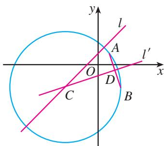

解法 1：设圆心 C 的坐标为 $(a, b)$ 。因为圆心 C 在直线 l: x - y + 1 = 0 上，所以

$$
a - b + 1 = 0.\tag{①}
$$

因为 A, B 是圆上两点，所以 $\left|CA\right|=\left|CB\right|$ .

根据两点间距离公式，有

$$
\sqrt {(a - 1) ^ {2} + (b - 1) ^ {2}} = \sqrt {(a - 2) ^ {2} + (b + 2) ^ {2}},
$$

即

$$
a - 3 b - 3 = 0.
$$

由①②可得 a = -3, b = -2. 所以圆心 C 的坐标是 $(-3, -2)$ .

②

圆的半径

  
图2.4-3

$$
r = | A C | = \sqrt {(1 + 3) ^ {2} + (1 + 2) ^ {2}} = 5.
$$

所以，所求圆的标准方程是

$$
(x + 3) ^ {2} + (y + 2) ^ {2} = 2 5.
$$

对应题目：[Q070000001189](../Q070000001189.md)

> 来源：高中选择性必修 第一册·人教A版数学
