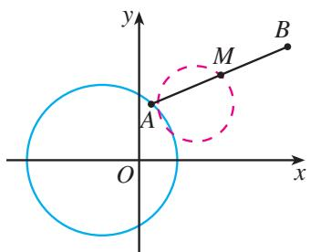

> [!faq]- 高中选择性必修 第一册·人教A版数学
> 分析：如图2.4-4，点 $A$ 运动引起点 $M$ 运动，而点 $A$ 在已知圆上运动，点 $A$ 的坐标满足方程 $(x + 1)^2 + y^2 = 4$ 。建立点 $M$ 与点 $A$ 坐标之间的关系，就可以利用点 $A$ 的坐标所满足的关系式得到点 $M$ 的坐标满足的关系式，求出点 $M$ 的轨迹方程。
>
> 
>
> 解：设点 M 的坐标是 $(x, y)$ ，点 A 的坐标是 $(x_{0}, y_{0})$ 。由于点 B 的坐标是 $(4, 3)$ ，且 M 是线段 AB 的中点，所以
>
> 图2.4-4
>
> $$
> x = \frac {x _ {0} + 4}{2}, y = \frac {y _ {0} + 3}{2}.
> $$
>
> 于是有
>
> $$
> x _ {0} = 2 x - 4, y _ {0} = 2 y - 3.\tag{①}
> $$
>
> 因为点 A 在圆 $(x+1)^{2}+y^{2}=4$ 上运动，所以点 A 的坐标满足圆的方程，即
>
> $$
> (x _ {0} + 1) ^ {2} + y _ {0} ^ {2} = 4.\tag{②}
> $$
>
> 把①代入②，得
>
> $$
> (2 x - 4 + 1) ^ {2} + (2 y - 3) ^ {2} = 4,
> $$
>
> 整理，得
>
> 点 M 的轨迹方程是指点 M 的坐标 $(x, y)$ 满足的关系式。轨迹是指点在运动变化过程中形成的图形。在解析几何中，我们常常把图形看作点的轨迹（集合）。
>
> $$
> \left(x - \frac {3}{2}\right) ^ {2} + \left(y - \frac {3}{2}\right) ^ {2} = 1.
> $$
>
> 这就是点 M 的轨迹方程，它表示以 $\left(\frac{3}{2}, \frac{3}{2}\right)$ 为圆心，半径为 1 的圆.
