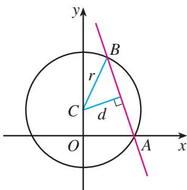

> [!faq]- 高中选择性必修 第一册·人教A版数学
> 解法2：圆 $C$ 的方程 $x^{2} + y^{2} - 2y - 4 = 0$ 可化为 $x^{2} + (y - 1)^{2} = 5$ ，因此圆心 $C$ 的坐标为 $(0,1)$ ，半径为 $\sqrt{5}$ ，圆心 $C(0,1)$ 到直线 $l$ 的距离
>
> $$
> d = \frac {\mid 3 \times 0 + 1 - 6 \mid}{\sqrt {3 ^ {2} + 1 ^ {2}}} = \frac {5}{\sqrt {1 0}} <   \sqrt {5}.
> $$
>
> 所以，直线 l 与圆 C 相交，有两个公共点.
>
> 如图 2.5-1，由垂径定理，得 $\left|AB\right|=2\sqrt{r^{2}-d^{2}}=\sqrt{10}$ .
>
> 
>
> 通过上述解法我们发现，在平面直角坐标系中，要判断直线 $l: Ax + By + C = 0$ 与圆 $C: (x - a)^{2} + (y - b)^{2} = r^{2}$ 的位置关系，可以联立它们的方程，通过判定方程组
>
> 图2.5-1
>
> $$
> \left\{ \begin{array}{l} A x + B y + C = 0, \\ (x - a) ^ {2} + (y - b) ^ {2} = r ^ {2} \end{array} \right.
> $$
>
> 的解的个数，得出直线与圆的公共点的个数，进而判断直线与圆的位置关系。若相交，可以由方程组解得两交点坐标，利用两点间的距离公式求得弦长。
>
> 我们还可以根据圆的方程求得圆心坐标与半径 r，从而求得圆心到直线的距离 d，通过比较 d 与 r 的大小，判断直线与圆的位置关系。若相交，则可利用勾股定理求得弦长。
>
> 适当地利用已知图形的几何性质，有助于简化计算.
