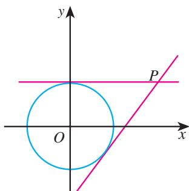

> [!faq]- 高中选择性必修 第一册·人教A版数学
> 解法1：设切线 $l$ 的斜率为 $k$ ，则切线 $l$ 的方程为 $y - 1 = k(x - 2)$ ，即 $kx - y + 1 - 2k = 0$
>
> 
> 图2.5-2
>
> 由圆心（0，0）到切线 $l$ 的距离等于圆的半径1，得
>
> $$
> \frac {\mid 1 - 2 k \mid}{\sqrt {k ^ {2} + 1}} = 1,
> $$
>
> 解得 k=0 或 $\frac{4}{3}$ .
>
> 因此，所求切线 l 的方程为 y=1，或 4x-3y-5=0.
