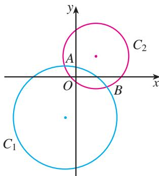

> [!faq]- 高中选择性必修 第一册·人教A版数学
> 解法2：把圆 $C_1$ 的方程化成标准方程，得
>
> $$
> (x + 1) ^ {2} + (y + 4) ^ {2} = 2 5,
> $$
>
> 圆 $C_1$ 的圆心是 $(-1, -4)$ ，半径 $r_1 = 5$ .
>
> 把圆 $C_2$ 的方程化成标准方程，得
>
> $$
> (x - 2) ^ {2} + (y - 2) ^ {2} = 1 0,
> $$
>
> 圆 $C_2$ 的圆心是 $(2, 2)$ ，半径 $r_2 = \sqrt{10}$ .
>
> 圆 $C_1$ 与圆 $C_2$ 的圆心距为
>
> $$
> \sqrt {(- 1 - 2) ^ {2} + (- 4 - 2) ^ {2}} = 3 \sqrt {5}.
> $$
>
> 
>
> 圆 $C_1$ 与圆 $C_2$ 的两半径之和 $r_1 + r_2 = 5 + \sqrt{10}$ ，两半径长之差 $r_1 - r_2 = 5 - \sqrt{10}$ .
>
> 图2.5-6
>
> 因为 $5 - \sqrt{10} < 3\sqrt{5} < 5 + \sqrt{10}$ ，即 $r_1 - r_2 < 3\sqrt{5} < r_1 + r_2$ ，所以圆 $C_1$ 与圆 $C_2$ 相交（图2.5-6），它们有两个公共点 $A, B$ .
