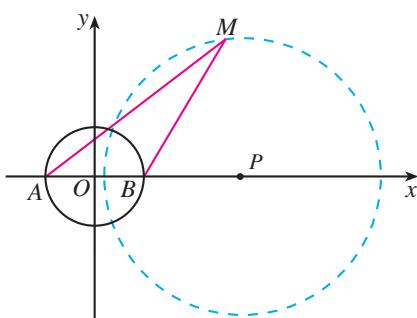

分析：我们可以通过建立适当的平面直角坐标系，求得满足条件的动点 $M$ 的轨迹方程，从而得到点 $M$ 的轨迹；通过研究它的轨迹方程与圆 $O$ 方程的关系，判断这个轨迹与圆 $O$ 的位置关系.

解：如图 2.5-7，以线段 AB 的中点 O 为原点，AB 所在直线为 x 轴，线段 AB 的垂直平分线为 y 轴，建立平面直角坐标系。由 AB=4，得 A(-2,0)，B(2,0)。

图2.5-7

设点 M 的坐标为 $(x, y)$ ，由 $|MA| = \sqrt{2} |MB|$ ，得

?

$$
\sqrt {(x + 2) ^ {2} + y ^ {2}} = \sqrt {2} \times \sqrt {(x - 2) ^ {2} + y ^ {2}},
$$

化简，得 $x^{2}-12x+y^{2}+4=0$ ，即 $(x-6)^{2}+y^{2}=32$ .

如果把本例中的“ $\sqrt{2}$ 倍”改为“ $k(k>0)$ 倍”，你能分析并解决这个问题吗？

所以点 M 的轨迹是以 $P(6,0)$ 为圆心，半径为 $4\sqrt{2}$ 的一个圆（图 2.5-7）.

因为两圆的圆心距为 $|PO| = 6$ ，两圆的半径分别为 $r_1 = 2$ ， $r_2 = 4\sqrt{2}$ ，又 $r_2 - r_1 < |PO| < r_2 + r_1$ ，所以点 $M$ 的轨迹与圆 $O$ 相交.

对应题目：[Q070000001218](../Q070000001218.md)

> 来源：高中选择性必修 第一册·人教A版数学
