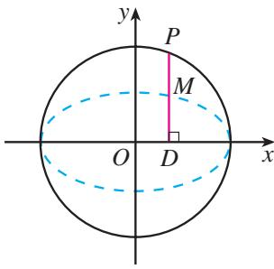

分析：点 $P$ 在圆 $x^{2} + y^{2} = 4$ 上运动，点 $P$ 的运动引起点 $M$ 运动。我们可以由 $M$ 为线段 $PD$ 的中点得到点 $M$ 与点 $P$ 坐标之间的关系式，并由点 $P$ 的坐标满足圆的方程得到点 $M$ 的坐标所满足的方程。

  
图3.1-5

解：设点 M 的坐标为 $(x, y)$ ，点 P 的坐标为 $(x_{0}, y_{0})$ ，则点 D 的坐标为 $(x_{0}, 0)$ 。由点 M 是线段 PD 的中点，得

$$
x = x _ {0}, y = \frac {y _ {0}}{2}.
$$

因为点 $P(x_0, y_0)$ 在圆 $x^2 + y^2 = 4$ 上，所以

$$
x _ {0} ^ {2} + y _ {0} ^ {2} = 4.\tag{①}
$$

把 $x_0 = x$ ， $y_0 = 2y$ 代入方程①，得

$$
x ^ {2} + 4 y ^ {2} = 4,
$$

即

$$
\frac {x ^ {2}}{4} + y ^ {2} = 1.
$$

所以点 M 的轨迹是椭圆.

寻求点 M 的坐标 $(x, y)$ 中 x, y 与 $x_{0}, y_{0}$ 之间的关系，然后消去 $x_{0}, y_{0}$ ，得到点 M 的轨迹方程。这是解析几何中求点的轨迹方程常用的方法。

利用信息技术，可以更方便地探究点 M 的轨迹的形状.

对应题目：[Q070000001266](../Q070000001266.md)

> 来源：高中选择性必修 第一册·人教A版数学
