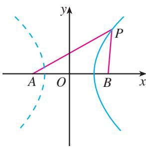

分析：先根据题意判断轨迹的形状．由声速及 A，B 两处听到炮弹爆炸声的时间差，可知 A，B 两处与爆炸点的距离的差为定值，所以爆炸点在以 A，B 为焦点的双曲线上．因为爆炸点离 A 处比离 B 处远，所以爆炸点应在靠近 B 处的双曲线的一支上．

解：如图3.2-5，建立平面直角坐标系 $Oxy$ ，使 $A$ ， $B$ 两点在 $x$ 轴上，并且原点 $O$ 与线段 $AB$ 的中点重合.

设炮弹爆炸点 $P$ 的坐标为 $(x, y)$ ，则

$$
\mid P A \mid - \mid P B \mid = 3 4 0 \times 2 = 6 8 0,
$$

即 2a=680, a=340.

又 $|AB|=800$ ，所以2c=800，c=400， $b^{2}=c^{2}-a^{2}=44\ 400$ .

因为 $|PA|-|PB|=680>0$ ，所以点P的轨迹是双曲线的右支，因此 $x\geqslant340$ .

图3.2-5

所以，炮弹爆炸点的轨迹方程为

$$
\frac {x ^ {2}}{1 1 5 6 0 0} - \frac {y ^ {2}}{4 4 4 0 0} = 1 (x \geqslant 3 4 0).
$$

利用两个不同的观测点 A, B 测得同一点 P 发出信号的时间差，可以确定点 P 所在双曲线的方程．如果再增设一个观测点 C，利用 B, C（或 A, C）两处测得的点 P 发出信号的时间差，就可以确定点 P 所在另一双曲线的方程．解这两个方程组成的方程组，就能确定点 P 的准确位置，这是双曲线的一个重要应用.

对应题目：[Q070000001295](../Q070000001295.md)

> 来源：高中选择性必修 第一册·人教A版数学
