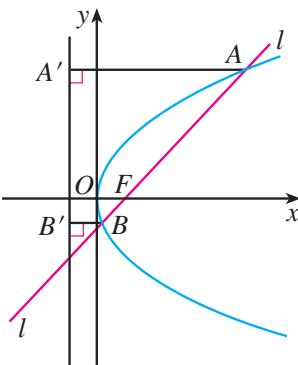

分析：由抛物线的方程可以得到它的焦点坐标，又直线 $l$ 的斜率为1，所以可以求出直线 $l$ 的方程；与抛物线的方程联立，可以求出 $A$ ， $B$ 两点的坐标；利用两点间的距离公式可以求出 $|AB|$ 。这种方法思路直接，具有一般性。请你用此方法求 $|AB|$ 。

下面介绍另外一种方法——数形结合的方法.

在图3.3-4中，设 $A(x_{1},y_{1})$ ， $B(x_{2},y_{2})$ .由抛物线的定义可知， $\vert AF\vert$ 等于点 $A$ 到准线的距离 $\vert AA^{\prime}\vert$ .由 $p = 2$ ， $\frac{p}{2} = 1$ ，得 $\vert AA^{\prime}\vert = x_{1} + \frac{p}{2} = x_{1} + 1$ ，于是 $\vert AF\vert = x_1 + 1.$ 同理， $\vert BF\vert =$ $\vert BB^{\prime}\vert = x_{2} + \frac{p}{2} = x_{2} + 1$ ，于是得

  
图3.3-4

$$
\vert A B \vert = \vert A F \vert + \vert B F \vert = x _ {1} + x _ {2} + p = x _ {1} + x _ {2} + 2.
$$

由此可见，只要求出点 A，B 的横坐标之和 $x_{1} + x_{2}$ ，就可以求出 $|AB|$ .

解：由题意可知， $p=2,\frac{p}{2}=1$ ，焦点F的坐标为（1，0），准线方程为x=-1．如图3.3-4，设 $A(x_{1},y_{1})$ ， $B(x_{2},y_{2})$ ，A，B两点到准线的距离分别为 $d_{A}$ ， $d_{B}$ ．由抛物线的定义，可知

$$
\left| A F \right| = d _ {A} = x _ {1} + 1, \left| B F \right| = d _ {B} = x _ {2} + 1,
$$

于是

$$
\vert A B \vert = \vert A F \vert + \vert B F \vert = x _ {1} + x _ {2} + 2.
$$

?

因为直线 l 的斜率为 1，且过焦点 $F(1,0)$ ，所以直线 l 的方程为

$$
y = x - 1.
$$

如果直线 $l$ 不经过焦点 $F$ ， $\vert AB\vert$ 还等于 $x_{1}+$ $x_{2} + 2$ 吗？

①

将①代入方程 $y^{2}=4x$ ，得 $(x-1)^{2}=4x$ ，化简，得

$$
x ^ {2} - 6 x + 1 = 0.
$$

所以

$$
x _ {1} + x _ {2} = 6,
$$

$$
\mid A B \mid = x _ {1} + x _ {2} + 2 = 8.
$$

所以，线段 $AB$ 的长是8.

对应题目：[Q070000001327](../Q070000001327.md)

> 来源：高中选择性必修 第一册·人教A版数学
