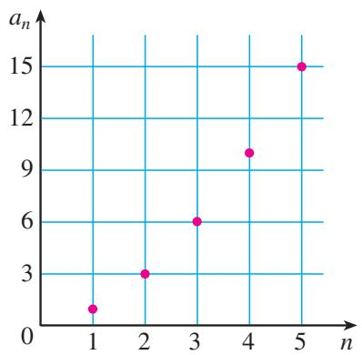
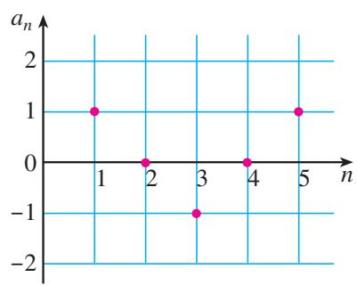

解：（1）当通项公式中的 $n = 1,2,3,4,5$ 时，数列 $\{a_{n}\}$ 的前5项依次为1，3，6，10，15.

图象如图 4.1-2(1) 所示.

  
(1)

  
(2)  
图4.1-2

(2) 当通项公式中的 n=1, 2, 3, 4, 5 时，数列 $\{a_{n}\}$ 的前 5 项依次为 1, 0, -1, 0, 1.

图象如图 4.1-2(2) 所示.

对应题目：[Q070000001373](../Q070000001373.md)

> 来源：高中选择性必修 第二册·人教A版数学
