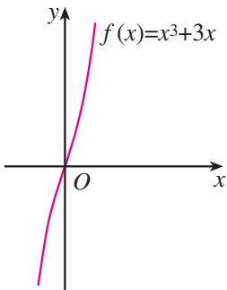
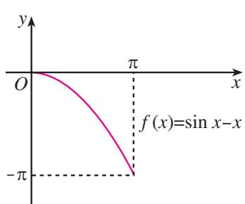
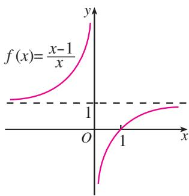

> [!faq]- 高中选择性必修 第二册·人教A版数学
> 解：（1）因为 $f(x) = x^{3} + 3x$ ，所以
>
> $$
> f ^ {\prime} (x) = 3 x ^ {2} + 3 = 3 \left(x ^ {2} + 1\right) > 0.
> $$
>
> 所以，函数 $f(x)=x^{3}+3x$ 在 R 上单调递增，如图 5.3-4(1) 所示.
>
> 
> (1)
>
> 
> (2)
> 图5.3-4
>
> 
> (3)
>
> (2) 因为 $f(x)=\sin x-x,\quad x\in(0,\pi)$ ，所以
>
> $$
> f ^ {\prime} (x) = \cos x - 1 <   0.
> $$
>
> 所以，函数 $f(x)=\sin x-x$ 在 $(0,\pi)$ 内单调递减，如图 5.3-4(2) 所示.
>
> （3）因为 $f(x) = 1 - \frac{1}{x}$ ， $x\in (-\infty ,0)\bigcup (0, + \infty)$ ，所以
>
> $$
> f ^ {\prime} (x) = \frac {1}{x ^ {2}} > 0.
> $$
>
> 所以，函数 $f(x) = \frac{x - 1}{x}$ 在区间 $(- \infty, 0)$ 和 $(0, +\infty)$ 上单调递增，如图5.3-4(3）所示.
