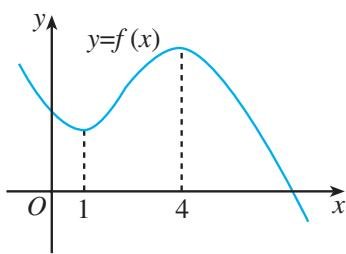

> [!faq]- 高中选择性必修 第二册·人教A版数学
> 解：当 1<x<4 时， $f'(x)>0$ ，可知 $f(x)$ 在区间 $(1,4)$ 内单调递增；
>
> 当 x<1，或 x>4 时， $f'(x)<0$ ，可知 $f(x)$ 在区间 $(-∞,1)$ 和 $(4,+∞)$ 上都单调递减；
>
> 
>
> 当 x=1，或 x=4 时， $f'(x)=0$ ，这两点比较特殊，我们称它们为“稳定点”.
>
> 综上，函数 $f(x)$ 图象的大致形状如图 5.3-5 所示.
>
> 图5.3-5
