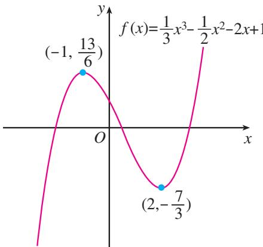

> [!faq]- 高中选择性必修 第二册·人教A版数学
> 解：函数 $f(x) = \frac{1}{3} x^3 - \frac{1}{2} x^2 - 2x + 1$ 的定义域为R. 对 $f(x)$ 求导数，得
>
> $$
> f ^ {\prime} (x) = x ^ {2} - x - 2 = (x + 1) (x - 2).
> $$
>
> 令 $f'(x)=0$ ，解得
>
> $$
> x = - 1, \text {或} x = 2.
> $$
>
> x = -1 和 x = 2 把函数定义域划分成三个区间， $f'(x)$ 在各区间上的正负，以及 $f(x)$ 的单调性如表 5.3-1 所示.
>
> 表5.3-1
>
> <table><tr><td>x</td><td>(-∞,-1)</td><td>-1</td><td>(-1,2)</td><td>2</td><td>(2,+∞)</td></tr><tr><td>f&#x27;(x)</td><td>+</td><td>0</td><td>-</td><td>0</td><td>+</td></tr><tr><td>f(x)</td><td>单调递增</td><td> $f(-1)=\frac{13}{6}$ </td><td>单调递减</td><td> $f(2)=-\frac{7}{3}$ </td><td>单调递增</td></tr></table>
>
> 所以， $f(x)$ 在 $(-∞, -1)$ 和 $(2, +∞)$ 上单调递增，在 $(-1, 2)$ 内单调递减，如图5.3-6所示.
>
> 
> 图5.3-6
>
> 如果不用导数的方法，直接运用单调性的定义，你如何求解本题？运算过程麻烦吗？你有什么体会？
>
> 一般情况下，我们可以通过如下步骤判断函数 $y = f(x)$ 的单调性：
>
> 第1步，确定函数的定义域；
>
> 第2步，求出导数 $f'(x)$ 的零点；
>
> 第 3 步，用 $f'(x)$ 的零点将 $f(x)$ 的定义域划分为若干个区间，列表给出 $f'(x)$ 在各区间上的正负，由此得出函数 $y=f(x)$ 在定义域内的单调性.
