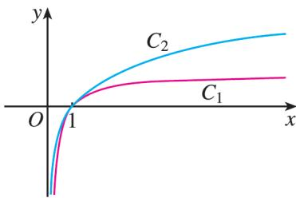

解：因为 $f(x) = \ln x$ ， $g(x) = 1 - \frac{1}{x}$ ，所以

$$
f ^ {\prime} (x) = \frac {1}{x}, g ^ {\prime} (x) = \frac {1}{x ^ {2}}.
$$

当 x=1 时， $f'(x)=g'(x)=1$ ;

当 0<x<1 时， $g'(x)>f'(x)>1$ ;

当 x>1 时， $0<g'(x)<f'(x)<1.$

所以， $f(x)$ ， $g(x)$ 在 $(0, +\infty)$ 上都是增函数。在区间 $(0, 1)$ 内， $g(x)$ 的图象比 $f(x)$ 的图象要“陡峭”；在区间 $(1, +\infty)$ 上， $g(x)$ 的图象比 $f(x)$ 的图象要“平缓”。

  
图5.3-8

所以， $f(x)$ ， $g(x)$ 的图象依次是图 5.3-8 中的 $C_{2}$ ， $C_{1}$ .

对应题目：[Q070000001582](../Q070000001582.md)

> 来源：高中选择性必修 第二册·人教A版数学
