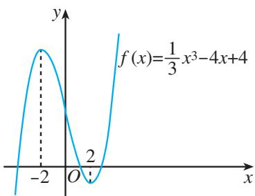

解：因为 $f(x) = \frac{1}{3} x^3 - 4x + 4$ ，所以

$$
f ^ {\prime} (x) = x ^ {2} - 4 = (x + 2) (x - 2).
$$

令 $f'(x)=0$ ，解得 x=-2，或 x=2。

当 x 变化时， $f'(x)$ ， $f(x)$ 的变化情况如表 5.3-2 所示.

表5.3-2

<table><tr><td>x</td><td>(-∞,-2)</td><td>-2</td><td>(-2,2)</td><td>2</td><td>(2,+∞)</td></tr><tr><td>f&#x27;(x)</td><td>+</td><td>0</td><td>-</td><td>0</td><td>+</td></tr><tr><td>f(x)</td><td>单调递增</td><td> $\frac{28}{3}$ </td><td>单调递减</td><td> $-\frac{4}{3}$ </td><td>单调递增</td></tr></table>

因此，当 $x = -2$ 时， $f(x)$ 有极大值，并且极大值为

$$
f (- 2) = \frac {2 8}{3};
$$

?

当 $x = 2$ 时， $f(x)$ 有极小值，并且极小值为

极大值一定大于极小值吗？

$$
f (2) = - \frac {4}{3}.
$$

函数 $f(x) = \frac{1}{3} x^3 - 4x + 4$ 的图象如图5.3-12所示.

  
图5.3-12

对应题目：[Q070000001586](../Q070000001586.md)

> 来源：高中选择性必修 第二册·人教A版数学
