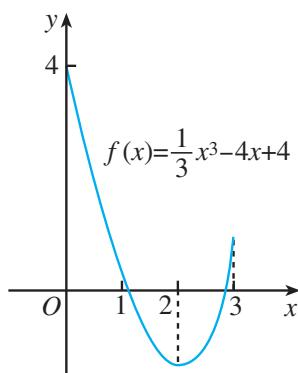

解：由例5可知，在区间 $[0,3]$ 上，当 $x = 2$ 时，函数 $f(x) = \frac{1}{3} x^3 -4x + 4$ 有极小值，并且极小值为 $f(2) = -\frac{4}{3}$

又由于

$$
f (0) = 4, f (3) = 1,
$$

所以，函数 $f(x) = \frac{1}{3} x^3 - 4x + 4$ 在区间[0, 3]上的最大值是 4，最小值是 $-\frac{4}{3}$ .

图5.3-16

上述结论可以从函数 $f(x) = \frac{1}{3} x^3 - 4x + 4$ 在区间[0, 3]上的图象（图5.3-16）得到直观验证.

一般地，求函数 $y = f(x)$ 在区间 $[a, b]$ 上的最大值与最小值的步骤如下：

(1) 求函数 $y=f(x)$ 在区间 $(a, b)$ 内的极值；

（2）将函数 $y = f(x)$ 的各极值与端点处的函数值 $f(a)$ ， $f(b)$ 比较，其中最大的一个是最大值，最小的一个是最小值.

观察例 4 中的图 5.3-8，我们发现，当 x > 0 时，

$$
1 - \frac {1}{x} \leqslant \ln x.\tag{①}
$$

怎样证明这个结论呢？

我们将不等式①转化为

$$
\frac {1}{x} - 1 + \ln x \geqslant 0.
$$

设 $s(x) = \frac{1}{x} - 1 + \ln x$ ，那么

$$
s ^ {\prime} (x) = - \frac {1}{x ^ {2}} + \frac {1}{x} = \frac {x - 1}{x ^ {2}}.
$$

令 $s'(x)=0$ ，解得 x=1。

当 x 变化时， $s'(x)$ ， $s(x)$ 的变化情况如表 5.3-3 所示.

表5.3-3

<table><tr><td>x</td><td>(0,1)</td><td>1</td><td>(1,+∞)</td></tr><tr><td>s&#x27;(x)</td><td>-</td><td>0</td><td>+</td></tr><tr><td>s(x)</td><td>单调递减</td><td>0</td><td>单调递增</td></tr></table>

所以，当 $x = 1$ 时， $s(x)$ 取得最小值。所以

$$
s (x) \geqslant s (1) = 0,
$$

即

$$
\frac {1}{x} - 1 + \ln x \geqslant 0.
$$

所以，当 $x > 0$ 时， $1 - \frac{1}{x} \leqslant \ln x$ .

对应题目：[Q070000001589](../Q070000001589.md)

> 来源：高中选择性必修 第二册·人教A版数学
