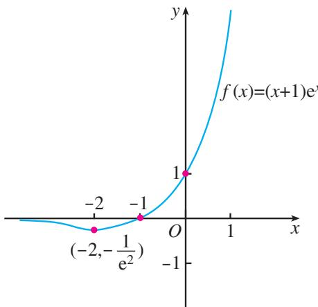

> [!faq]- 高中选择性必修 第二册·人教A版数学
> 解：（1）函数的定义域为 R.
>
> $$
> \begin{array}{r l} f ^ {\prime} (x) & = (x + 1) ^ {\prime} \mathrm{e} ^ {x} + (x + 1) (\mathrm{e} ^ {x}) ^ {\prime} \\ & = \mathrm{e} ^ {x} + (x + 1) \mathrm{e} ^ {x} \\ & = (x + 2) \mathrm{e} ^ {x}. \end{array}
> $$
>
> 令 $f'(x)=0$ ，解得 x=-2。
>
> $f'(x)$ ， $f(x)$ 的变化情况如表5.3-4所示.
>
> 表 5.3-4
>
> <table><tr><td>x</td><td> $(-\infty, -2)$ </td><td>-2</td><td> $(-2, +\infty)$ </td></tr><tr><td> $f'(x)$ </td><td>-</td><td>0</td><td>+</td></tr><tr><td> $f(x)$ </td><td>单调递减</td><td> $-\frac{1}{e^{2}}$ </td><td>单调递增</td></tr></table>
>
> 所以， $f(x)$ 在区间 $(-∞, -2)$ 上单调递减，在区间 $(-2, +∞)$ 上单调递增.
> 当 x = -2 时， $f(x)$ 有极小值 $f(-2) = -\frac{1}{\mathrm{e}^{2}}$ .
>
> (2) 令 $f(x) = 0$ ，解得 $x = -1$ .
>
> 当 $x < -1$ 时， $f(x) < 0$ ；当 $x > -1$ 时， $f(x) > 0$ .
>
> 所以， $f(x)$ 的图象经过特殊点 $A\left(-2, -\frac{1}{\mathrm{e}^{2}}\right)$ ， $B(-1, 0)$ ， $C(0, 1)$ .
>
> 当 $x \to -\infty$ 时，与一次函数相比，指数函数 $y = \mathrm{e}^{-x}$ 呈爆炸性增长，从而 $f(x) = \frac{x + 1}{\mathrm{e}^{-x}} \to 0$ ；当 $x \to +\infty$ 时， $f(x) \to +\infty$ ， $f'(x) \to +\infty$ 。
>
> 根据以上信息，我们画出 $f(x)$ 的大致图象如图 5.3-17 所示.
>
> 
> 图5.3-17
>
> （3）方程 $f(x) = a (a \in \mathbf{R})$ 的解的个数为函数 $y = f(x)$ 的图象与直线 $y = a$ 的交点个数.
>
> 由（1）及图5.3-17可得，当 $x = -2$ 时， $f(x)$ 有最小值 $f(-2) = -\frac{1}{\mathrm{e}^2}$ .
>
> 所以，关于方程 $f(x) = a (a \in \mathbf{R})$ 的解的个数有如下结论：
>
> 当 $a < -\frac{1}{\mathrm{e}^2}$ 时，解为0个；
>
> 当 $a = -\frac{1}{\mathrm{e}^2}$ 或 $a \geqslant 0$ 时，解为1个；
>
> 当 $-\frac{1}{\mathrm{e}^2} < a < 0$ 时，解为2个.
>
> 由例7可见，函数 $f(x)$ 的图象直观地反映了函数 $f(x)$ 的性质。通常，可以按如下步骤画出函数 $f(x)$ 的大致图象：
>
> (1) 求出函数 $f(x)$ 的定义域;
>
> (2) 求导数 $f'(x)$ 及函数 $f'(x)$ 的零点；
>
> （3）用 $f'(x)$ 的零点将 $f(x)$ 的定义域划分为若干个区间，列表给出 $f'(x)$ 在各区间上的正负，并得出 $f(x)$ 的单调性与极值；
>
> （4）确定 $f(x)$ 的图象所经过的一些特殊点，以及图象的变化趋势；
>
> (5) 画出 $f(x)$ 的大致图象.
>
> 下面我们通过实例介绍导数在解决实际问题中的应用.
