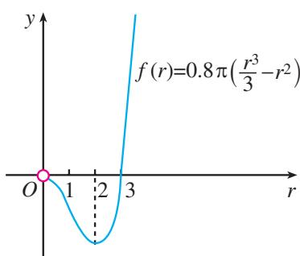

解：由题意可知，每瓶饮料的利润是

$$
y = f (r) = 0. 2 \times \frac {4}{3} \pi r ^ {3} - 0. 8 \pi r ^ {2} = 0. 8 \pi \left(\frac {r ^ {3}}{3} - r ^ {2}\right), 0 <   r \leqslant 6.
$$

所以

$$
f ^ {\prime} (r) = 0. 8 \pi (r ^ {2} - 2 r).
$$

令 $f'(r)=0$ ，解得 r=2。

当 $r \in (0, 2)$ 时， $f'(r) < 0$ ；当 $r \in (2, 6)$ 时， $f'(r) > 0$ .

因此，当半径 r>2 时， $f'(r)>0$ ， $f(r)$ 单调递增，即半径越大，利润越高；当半径 r<2 时， $f'(r)<0$ ， $f(r)$ 单调递减，即半径越大，利润越低.

(1) 半径为 $6 \, cm$ 时，利润最大.

（2）半径为 $2\mathrm{cm}$ 时，利润最小，这时 $f(2) < 0$ ，表示此种瓶内饮料的利润还不够瓶子的成本，此时利润是负值.

换一个角度：如果我们不用导数工具，直接从函数 $f(r)$ 的图象（图5.3-18）上观察，你有什么发现？

从图象上容易看出，当 r=3 时， $f(3)=0$ ，即瓶子的半径是 3 cm 时，饮料的利润与饮料瓶的成本恰好相等；当 r>3 时，利润才为正值.

当 $r \in (0, 2)$ 时， $f(r)$ 单调递减，你能解释它的实际意义吗？

图5.3-18

通过此问题的解决，我们很容易回答开始时的问题。请同学们自己作出回答。

对应题目：[Q070000001593](../Q070000001593.md)

> 来源：高中选择性必修 第二册·人教A版数学
