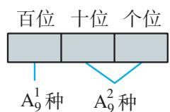

> [!faq]- 高中选择性必修 第三册·人教A版数学
> 解法 1：如图 6.2-5 所示，由于三位数的百位上的数字不能是 0，所以可以分两步完成：第 1 步，确定百位上的数字，可以从 1～9 这 9 个数字中取出 1 个，有 $A_{9}^{1}$ 种取法；第 2 步，确定十位和个位上的数字，可以从剩下的 9 个数字中取出 2 个，有 $A_{9}^{2}$ 种取法。根据分步乘法计数原理，所求的三位数的个数为
>
> 
> 图6.2-5
>
> $$
> \mathrm{A} _ {9} ^ {1} \times \mathrm{A} _ {9} ^ {2} = 9 \times 9 \times 8 = 6 4 8.
> $$
