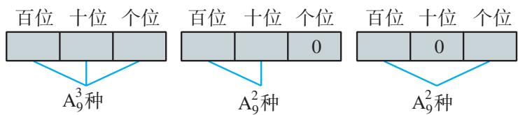

解法 2：如图 6.2-6 所示，符合条件的三位数可以分成三类：第 1 类，每一位数字都不是 0 的三位数，可以从 1～9 这 9 个数字中取出 3 个，有 $A_{9}^{3}$ 种取法；第 2 类，个位上的数字是 0 的三位数，可以从剩下的 9 个数字中取出 2 个放在百位和十位，有 $A_{9}^{2}$ 种取法；第 3 类，十位上的数字是 0 的三位数，可以从剩下的 9 个数字中取出 2 个放在百位和个位，有 $A_{9}^{2}$ 种取法。

  
图6.2-6

根据分类加法计数原理，所求三位数的个数为

$$
\mathrm{A} _ {9} ^ {3} + \mathrm{A} _ {9} ^ {2} + \mathrm{A} _ {9} ^ {2} = 9 \times 8 \times 7 + 9 \times 8 + 9 \times 8 = 6 4 8.
$$

对应题目：[Q070000001666](../Q070000001666.md)

> 来源：高中选择性必修 第三册·人教A版数学
