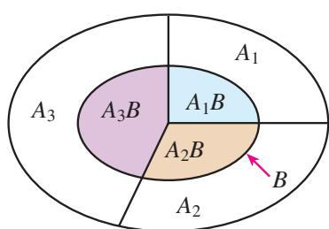

分析：取到的零件可能来自第1台车床，也可能来自第2台或第3台车床，有3种可能。设 $B =$ “任取一零件为次品”， $A_{i} =$ “零件为第 $i$ 台车床加工” $(i = 1,2,3)$ ，如图7.1-3所示，可将事件 $B$ 表示为3个两两互斥事件的并，利用全概率公式可以计算出事件 $B$ 的概率。

解：设 B=“任取一个零件为次品”， $A_{i}=$ “零件为第 i 台车床加工”（i=1,2,3），则 $\Omega=A_{1}\cup A_{2}\cup A_{3}$ ，且 $A_{1}$ ， $A_{2}$ ， $A_{3}$ 两两互斥。根据题意得

图7.1-3

$$
\begin{array}{l} P (A _ {1}) = 0. 2 5, P (A _ {2}) = 0. 3, P (A _ {3}) = 0. 4 5, \\ P (B \mid A _ {1}) = 0. 0 6, P (B \mid A _ {2}) = P (B \mid A _ {3}) = 0. 0 5. \end{array}
$$

(1) 由全概率公式，得

$$
\begin{array}{r l} P (B) & = P \left(A _ {1}\right) P \left(B \mid A _ {1}\right) + P \left(A _ {2}\right) P \left(B \mid A _ {2}\right) + P \left(A _ {3}\right) P \left(B \mid A _ {3}\right) \\ & = 0. 2 5 \times 0. 0 6 + 0. 3 \times 0. 0 5 + 0. 4 5 \times 0. 0 5 \\ & = 0. 0 5 2 5. \end{array}
$$

(2) “如果取到的零件是次品, 计算它是第 $i (i = 1, 2, 3)$ 台车床加工的概率”, 就是第七章 随机变量及其分布

计算在 B 发生的条件下，事件 $A_{i}$ 发生的概率.

$$
P \left(A _ {1} \mid B\right) = \frac {P \left(A _ {1} B\right)}{P (B)} = \frac {P \left(A _ {1}\right) P \left(B \mid A _ {1}\right)}{P (B)} = \frac {0 . 2 5 \times 0 . 0 6}{0 . 0 5 2 5} = \frac {2}{7}.
$$

类似地，可得

$$
P (A _ {2} \mid B) = \frac {2}{7}, P (A _ {3} \mid B) = \frac {3}{7}.
$$

对应题目：[Q070000001735](../Q070000001735.md)

> 来源：高中选择性必修 第三册·人教A版数学
