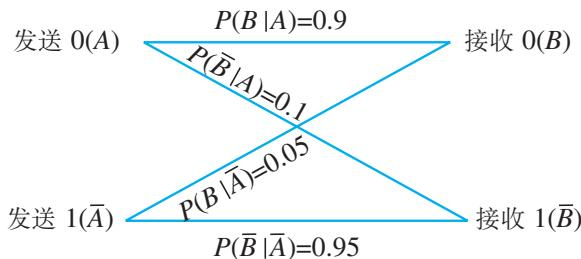

分析：设 A = “发送的信号为 0”，B = “接收到的信号为 0”。为便于求解，我们可将题目中所包含的各种信息用图 7.1-4 直观表示。

  
图7.1-4

解：设 A = “发送的信号为 0”，B = “接收到的信号为 0”，则 $\overline{A} =$ “发送的信号为 1”， $\overline{B} =$ “接收到的信号为 1”。由题意得

$$
P (A) = P (\bar {A}) = 0. 5, \quad P (B | A) = 0. 9, \quad P (\bar {B} | A) = 0. 1,
$$

$$
P (B \mid \overline {{A}}) = 0. 0 5, P (\overline {{B}} \mid \overline {{A}}) = 0. 9 5.
$$

(1) $P(B) = P(A)P(B|A) + P(\overline{A})P(B|\overline{A}) = 0.5\times 0.9 + 0.5\times 0.05 = 0.475,$

$$
P (B) = 1 - P (B) = 1 - 0. 4 7 5 = 0. 5 2 5.
$$

$$
P (\overline {{A}} \mid B) = \frac {P (\overline {{A}}) P (B \mid \overline {{A}})}{P (B)} = \frac {0 . 5 \times 0 . 0 5}{0 . 4 7 5} = \frac {1}{1 9}. \tag {2}
$$

对应题目：[Q070000001736](../Q070000001736.md)

> 来源：高中选择性必修 第三册·人教A版数学
