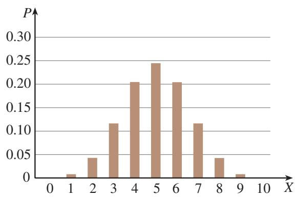

分析：小球落入哪个格子取决于在下落过程中与各小木钉碰撞的结果。设试验为观察小球碰到小木钉后下落的方向，有“向左下落”和“向右下落”两种可能结果，且概率都是0.5。在下落的过程中，小球共碰撞小木钉10次，且每次碰撞后下落方向不受上一次下落方向的影响，因此这是一个10重伯努利试验。小球最后落入格子的号码等于向右落下的次数，因此 $X$ 服从二项分布。

解：设 A = “向右下落”，则 $\overline{A} =$ “向左下落”，且 $P(A) = P(\overline{A}) = 0.5$ 。因为小球最后落入格子的号码 X 等于事件 A 发生的次数，而小球在下落的过程中共碰撞小木钉 10 次，所以 $X \sim B(10, 0.5)$ . 于是，X 的分布列为

图7.4-2  
  
图7.4-3

$$
P (X = k) = \mathrm{C} _ {1 0} ^ {k} \times 0. 5 ^ {1 0}, k = 0, 1, 2, \dots , 1 0.
$$

X 的概率分布图如图 7.4-3 所示.

对应题目：[Q070000001783](../Q070000001783.md)

> 来源：高中选择性必修 第三册·人教A版数学
