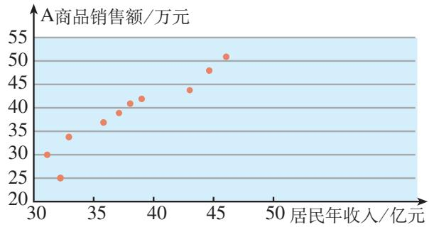

> [!faq]- 高中选择性必修 第三册·人教A版数学
> 解：画出成对样本数据的散点图，如图8.1-6所示．从散点图看，A商品销售额与居民年收入的样本数据呈现出线性相关关系.
>
> 
> 图8.1-6
>
> 由样本数据计算得样本相关系数 $r \approx 0.95$ 。由此可以推断，A 商品销售额与居民年收入正线性相关，即 A 商品销售额与居民年收入有相同的变化趋势，且相关程度很强。
