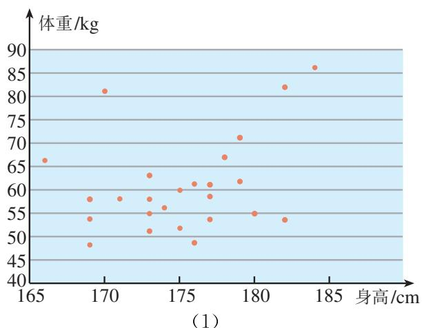
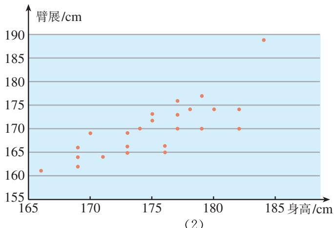

解：根据样本数据画出体重与身高、臂展与身高的散点图，分别如图8.1-7(1)和(2)所示，两个散点图都呈现出线性相关的特征.

  
图8.1-7  
第八章 成对数据的统计分析

通过计算得到体重与身高、臂展与身高的样本相关系数分别约为0.34和0.78，都为正线性相关。其中，臂展与身高的相关程度更高。

对应题目：[Q070000001833](../Q070000001833.md)

> 来源：高中选择性必修 第三册·人教A版数学
