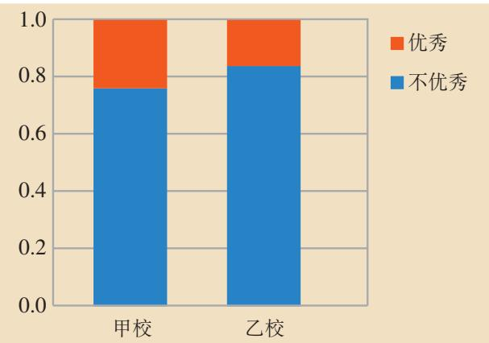

> [!faq]- 高中选择性必修 第三册·人教A版数学
> 解：用 $\Omega$ 表示两所学校的全体学生构成的集合．考虑以 $\Omega$ 为样本空间的古典概型.对于 $\Omega$ 中每一名学生，定义分类变量 $X$ 和 $Y$ 如下：
>
> $$
> X = \left\{ \begin{array}{l l} 0, & \text {该生来自甲校，} \\ 1, & \text {该生来自乙校，} \end{array} \right. Y = \left\{ \begin{array}{l l} 0, & \text {该生数学成绩不优秀，} \\ 1, & \text {该生数学成绩优秀。} \end{array} \right.
> $$
>
> 我们将所给数据整理成表 8.3-2.
>
> 表8.3-2
> 单位：人
>
> <table><tr><td rowspan="2">学校</td><td colspan="2">数学成绩</td><td rowspan="2">合计</td></tr><tr><td>不优秀(Y=0)</td><td>优秀(Y=1)</td></tr><tr><td>甲校(X=0)</td><td>33</td><td>10</td><td>43</td></tr><tr><td>乙校(X=1)</td><td>38</td><td>7</td><td>45</td></tr><tr><td>合计</td><td>71</td><td>17</td><td>88</td></tr></table>
>
> 表 8.3-2 是关于分类变量 X 和 Y 的抽样数据的 $2 \times 2$ 列联表：最后一行的前两个数分别是事件 $\{Y=0\}$ 和 $\{Y=1\}$ 的频数；最后一列的前两个数分别是事件 $\{X=0\}$ 和 $\{X=1\}$ 的频数；中间的四个格中的数是事件 $\{X=x, Y=y\}$ （x, y=0, 1）的频数；右下角格中的数是样本容量。因此，甲校学生中数学成绩不优秀和数学成绩优秀的频率分别为
>
> 第八章 成对数据的统计分析
>
> $\frac{33}{43}\approx0.767\ 4$ 和 $\frac{10}{43}\approx0.232\ 6;$
>
> 乙校学生中数学成绩不优秀和数学成绩优秀的频率分别为
>
> $\frac{38}{45} \approx 0.8444$ 和 $\frac{7}{45} \approx 0.1556$ .
>
> 我们可以用等高堆积条形图直观地展示上述计算结果，如图 8.3-1 所示.
>
> 
> 图8.3-1
>
> 利用统计软件画条形图，有些电子表格软件可以通过插入图表，从图表类型中选取条形图；R 软件可以用函数 barplot.
>
> 在图8.3-1中，左边的蓝色和红色条的高度分别是甲校学生中数学成绩不优秀和数学成绩优秀的频率；右边的蓝色和红色条的高度分别是乙校学生中数学成绩不优秀和数学成绩优秀的频率。通过比较发现，两个学校学生抽样数据中数学成绩优秀的频率存在差异，甲校的频率明显高于乙校的频率。依据频率稳定于概率的原理，我们可以推断 $P(Y = 1|X = 0) > P(Y = 1|X = 1)$ 。也就是说，如果从甲校和乙校各随机选取一名学生，那么甲校学生数学成绩优秀的概率大于乙校学生数学成绩优秀的概率。因此，可以认为两校学生的数学成绩优秀率存在差异，甲校学生的数学成绩优秀率比乙校学生的高。
