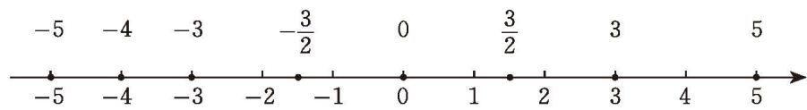

> [!success]- 例题解析
>
> > [!success] **【答案】** 详见解析
>
> > [!note]- **【解析】**
> > 解：(1) 点 A 表示 -2, 点 B 表示 2, 点 C 表示 0, 点 D 表示 -1;
> >
> > (2) 如图 2-6 所示。
> >
> > 
> > 图2-6

对应题目：[Q070000001950](../Q070000001950.md)

> 来源：北师大版初中数学·七年级上册
