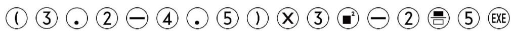
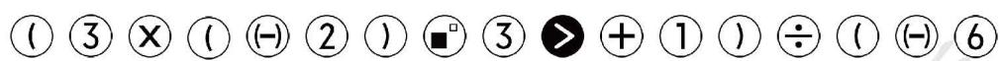

> [!success]- 北师大版初中数学·七年级上册
>
> > [!success] **【答案】** 详见解析
>
> > [!note]- **【解析】**
> > 解：(1) 按键顺序为
> >
> > 
> >
> > 计算器显示结果为 $-\frac{121}{10}$ ，可以按 $\uparrow$ (EXE) 键切换为小数格式 -12.1，所以 $(3.2-4.5)\times3^{2}-\frac{2}{5}=-12.1$ 。
> >
> > (2) 按键顺序为
> >
> > 
> >
> > 
> >
> > 计算器显示结果为 $\frac{115}{6}$ 。
> > 此时, 若按 $\uparrow$ EXE键, 则结果切换为小数格式 19.166 666 67。这一结果显然不是准确值, 而是一个近似数。在用计算器计算时, 所得到的结果有时候是近似数。为了得到所需精确度的近似数, 常采用四舍五入法。
