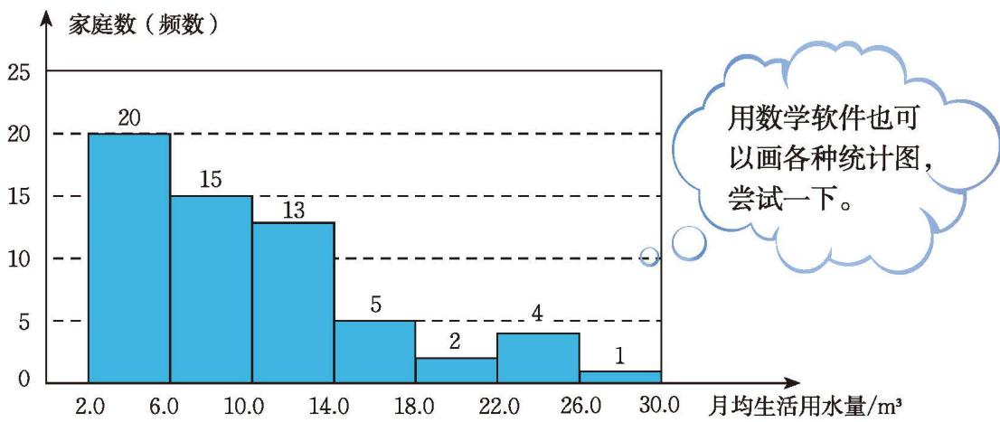

> [!success]- 例题解析
>
> > [!success] **【答案】** 详见解析
>
> > [!note]- **【解析】**
> > 解：(1) 确定所给数据中的最大值和最小值: 上述数据中最大值是 26.8, 最小值是 2.2。
> >
> > (2) 将数据适当分组: 最大值和最小值相差 $26.8 - 2.2 = 24.6$ , 组数太多或太少, 都会影响对数据整体状况的了解。考虑以 $4 \mathrm{~m}^{3}$ 为组距 (每组两个端点之间的距离称为组距), $24.6 \div 4 = 6.15$ , 可以考虑分成 7 组。
> >
> > (3) 统计每组中数据出现的次数:
> >
> > <table><tr><td>分组</td><td>家庭数(频数)</td><td>分组</td><td>家庭数(频数)</td></tr><tr><td>2.0~6.0</td><td>20</td><td>18.0~22.0</td><td>2</td></tr><tr><td>6.0~10.0</td><td>15</td><td>22.0~26.0</td><td>4</td></tr><tr><td>10.0~14.0</td><td>13</td><td>26.0~30.0</td><td>1</td></tr><tr><td>14.0~18.0</td><td>5</td><td></td><td></td></tr></table>
> >
> > (4) 绘制频数直方图（如图 6-12）:
> >
> > 
> > 图6-12

对应题目：[Q070000002301](../Q070000002301.md)

> 来源：北师大版初中数学·七年级上册
