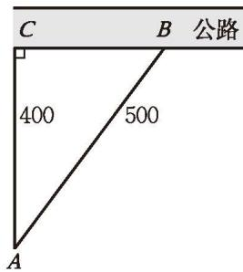

> [!success]- 例题解析
>
> > [!success] **【答案】** 详见解析
>
> > [!note]- **【分析】**
> > 你能根据题意画出图形吗？在你画的图形中存在一个怎样的三角形？
>
> > [!note]- **【解析】**
> > 解：根据题意, 可以画出图 1-9, 其中点 $A$ 表示王叔叔所在位置, 点 $C$ , 点 $B$ 表示两个时刻蓝方汽车的位置。由于王叔叔距离公路 $400 \mathrm{~m}$ , 因此 $\angle C$ 是直角。由勾股定理, 可得
> >
> > $$
> > A B ^ {2} = B C ^ {2} + A C ^ {2},
> > $$
> >
> > 也就是
> >
> > $$
> > 500 ^ {2} = B C ^ {2} + 400 ^ {2} \text { 。 }
> > $$
> >
> > 所以 $BC = 300\mathrm{m}$ 。
> > 蓝方汽车 10 s 行驶了 300 m，那么它平均每秒行驶
> >
> > $$
> > 300 \div 10 = 30 (\mathrm{m}) _ {\circ}
> > $$
> >
> > 因此，蓝方汽车这 10 s 的平均速度为 30 m/s。
> >
> > 
> > 图 1-9

对应题目：[Q070000002342](../Q070000002342.md)

> 来源：北师大版初中数学·八年级上册
