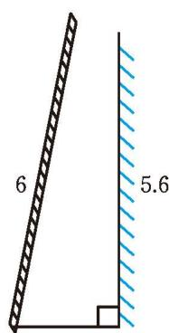

> [!success]- 例题解析
>
> > [!success] **【答案】** 详见解析
>
> > [!note]- **【解析】**
> > 解：设梯子稳定摆放时它的顶端抵达的高度为 $x \mathrm{~m}$ ，此时梯子底端到墙的距离恰为梯子长度的 $\frac{1}{3}$ 。根据勾股定理，有
> >
> > 
> > 图2-7
> >
> > $$
> > x ^ {2} + \left(6 \times \frac {1}{3}\right) ^ {2} = 6 ^ {2},
> > $$
> >
> > 即
> >
> > $$
> > x ^ {2} = 32, x = \sqrt {32} 。
> > $$
> >
> > 因为 $5.6^{2} = 31.36 < 32$ ，所以 $\sqrt{32} > 5.6$ 。
> > 因此，梯子稳定摆放时，它的顶端能抵达 $5.6 \, m$ 高的墙头。

对应题目：[Q070000002409](../Q070000002409.md)

> 来源：北师大版初中数学·八年级上册
