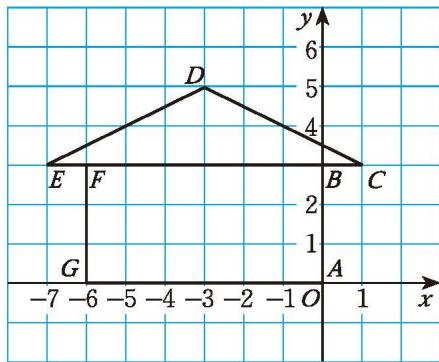

> [!success]- 例题解析
>
> > [!success] **【答案】** 详见解析
>
> > [!note]- **【解析】**
> > 解：如图 3-11，各点连接起来的图形像“房子”。
> >
> > （1）线段 AG 上的点都在 x 轴上，它们的纵坐标都是 0；线段 AB 上的点、线段 CD 与 y 轴的交点都在 y 轴上，它们的横坐标都是 0。
> >
> > 
> > 图3-11
> >
> > (2) 线段 $EC$ 与 $x$ 轴平行, 点 $E$ 和点 $C$ 的纵坐标相同; 线段 $EC$ 上其他点的纵坐标也相同, 都是 3。
> >
> > (3) 点 $F$ 和点 $G$ 的横坐标相同, 线段 $FG$ 与 $y$ 轴平行。

对应题目：[Q070000002488](../Q070000002488.md)

> 来源：北师大版初中数学·八年级上册
