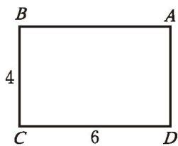
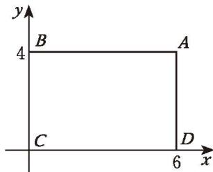

> [!success]- 北师大版初中数学·八年级上册
>
> > [!success] **【答案】** 详见解析
>
> > [!note]- **【解析】**
> > 解：如图 3-14, 以点 $C$ 为原点, 分别以 $C D$ , $C B$ 所在直线为 $x$ 轴、 $y$ 轴, 建立平面直角坐标系。此时点 $C$ 的坐标是 $(0, 0)$ 。
> >
> > 
> > 图3-13
> >
> > 
> > 图3-14
> >
> > 由 $CD = 6, CB = 4$ ，可得 $D, B, A$ 的坐标分别是 $D(6,0), B(0,4), A(6,4)$ 。
