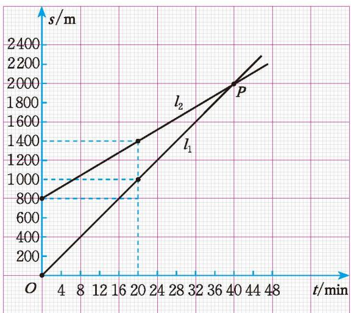

> [!success]- 北师大版初中数学·八年级上册
>
> > [!success] **【答案】** 详见解析
>
> > [!note]- **【解析】**
> > 解：(1) 当 $t = 0$ 时, 甲到观景台 1 的路程为 $0 \mathrm{~m}$ , 即 $s = 0$ , 故 $l_{1}$ 表示甲到观景台 1 的路程与追赶时间之间的关系。
> >
> > (2) $t$ 从 0 增加到 20 时, $l_{1}$ 上点的纵坐标增加了 1000 , $l_{2}$ 上点的纵坐标增加了 600 , 即 $20 \mathrm{~min}$ 内, 甲行走了 $1000 \mathrm{~m}$ , 乙行走了 $600 \mathrm{~m}$ , 所以甲的速度快。
> >
> > (3) 如图 4-13, 延长 $l_{1}, l_{2}$ , 可以看出, 当 $t = 30$ 时, $l_{1}$ 上的对应点在 $l_{2}$ 上对应点的下方, 这表明, $30 \mathrm{~min}$ 时甲尚未追上乙。
> >
> > 
> > 图4-13
> >
> > 
> >
> > (4) 在图 4-13 中, $l_{1}$ 与 $l_{2}$ 的交点 $P$ 的纵坐标小于 $(800 + 1300 = )2100$ , 这说明, 甲能在到达观景台 3 前追上乙。
> >
> > (5) $k_{1}$ 表示甲的速度, $k_{2}$ 表示乙的速度。甲的速度是 $50 \mathrm{~m} / \mathrm{min}$ , 乙的速度是 $30 \mathrm{~m} / \mathrm{min}$ 。
